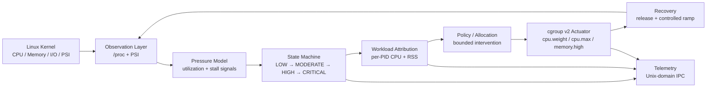
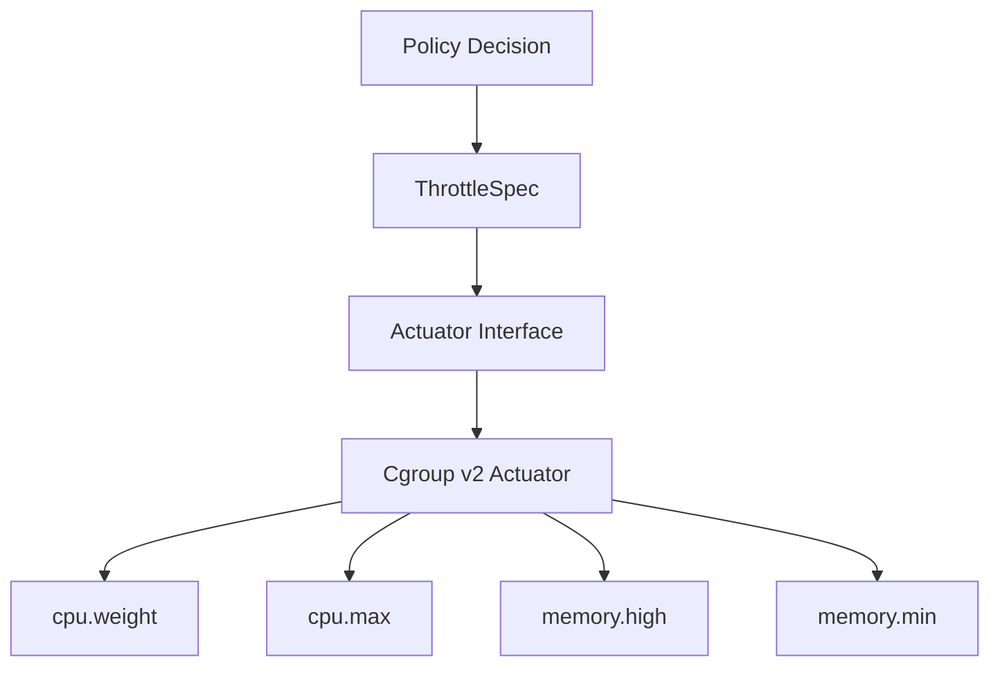
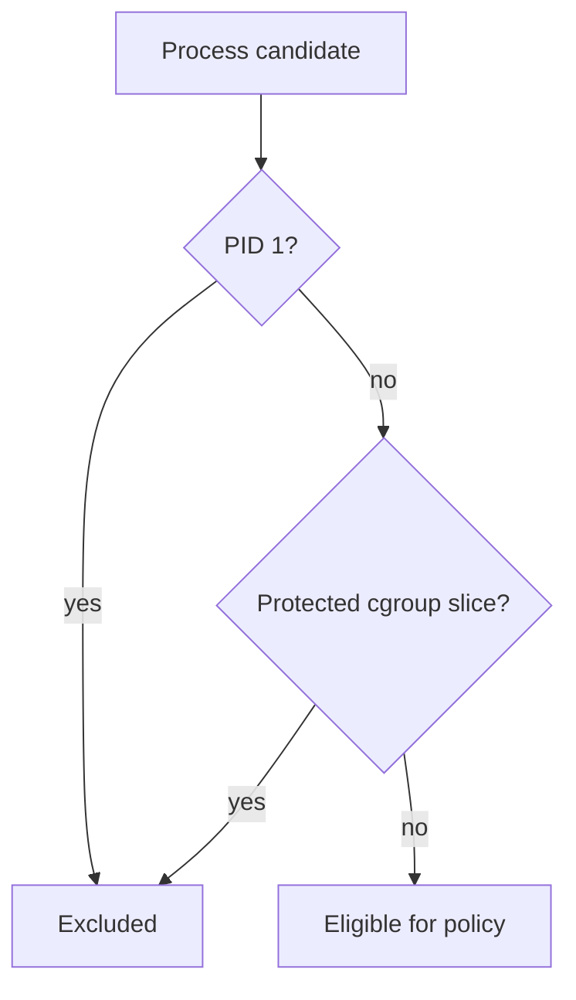
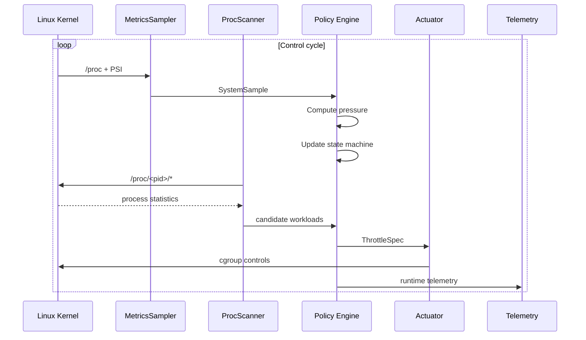

# SENTRY

### Policy-Driven Linux Resource Arbitration

> **Observe system pressure. Attribute contention. Apply bounded resource control. Recover deterministically.**

SENTRY is a Linux-first resource arbitration daemon that monitors **CPU, memory, I/O and Linux Pressure Stall Information (PSI)**, classifies system pressure, identifies dominant resource consumers, and applies **reversible cgroup v2 controls** to reduce contention.

It is designed around a simple systems objective:

> **Preserve useful system responsiveness under resource contention without terminating workloads.**

[](https://kernel.org/)
[](https://www.python.org/)
[](https://docs.kernel.org/admin-guide/cgroup-v2.html)
[](https://docs.kernel.org/accounting/psi.html)
[](LICENSE)
[](#limitations)

---

## Why SENTRY Exists

Linux already provides excellent primitives for observing and controlling resource usage:

* `/proc`
* Pressure Stall Information
* cgroup v2
* CPU bandwidth control
* CPU scheduling weights
* memory pressure controls
* systemd integration

The missing layer is **policy**.

The kernel can answer:

> How much CPU is being consumed?

and cgroup v2 can answer:

> How can this workload be constrained?

SENTRY addresses the intermediate question:

> **Given the current contention state, which workload should yield, how aggressively should it yield, and when should its resources be restored?**

That places SENTRY above Linux resource-control primitives rather than attempting to replace them.

---

# System Model



### Control-loop abstraction

```text
       ┌──────────────────────────────────────────────┐
       │                SENTRY CONTROL                 │
       └──────────────────────────────────────────────┘

                    ┌───────────────┐
                    │   OBSERVE     │
                    │               │
                    │ CPU           │
                    │ Memory        │
                    │ I/O           │
                    │ PSI           │
                    └───────┬───────┘
                            │
                            ▼
                    ┌───────────────┐
                    │    EVALUATE   │
                    │               │
                    │ Pressure      │
                    │ Classification│
                    │ State          │
                    └───────┬───────┘
                            │
                            ▼
                    ┌───────────────┐
                    │    ATTRIBUTE  │
                    │               │
                    │ Which PIDs    │
                    │ dominate load?│
                    └───────┬───────┘
                            │
                            ▼
                    ┌───────────────┐
                    │    ARBITRATE  │
                    │               │
                    │ Select policy │
                    │ Allocate limits│
                    └───────┬───────┘
                            │
                            ▼
                    ┌───────────────┐
                    │    ACTUATE    │
                    │               │
                    │ cgroup v2     │
                    │ cpu / memory  │
                    └───────┬───────┘
                            │
                            ▼
                    ┌───────────────┐
                    │    RECOVER    │
                    │               │
                    │ Release /     │
                    │ ramp back     │
                    └───────┬───────┘
                            │
                            └──────────────► OBSERVE
```

---

# What SENTRY Actually Does

SENTRY continuously evaluates the host rather than reacting to a single instantaneous CPU reading.

### 1. Observe

Kernel telemetry is sampled from:

```text
/proc/stat
/proc/meminfo
/proc/<pid>/stat
/proc/<pid>/statm
/proc/pressure/cpu
/proc/pressure/memory
/proc/pressure/io
```

The current implementation computes:

* CPU utilization
* memory utilization
* I/O wait
* optional PSI signals
* per-process CPU contribution
* resident memory size

---

### 2. Evaluate

A normalized pressure score is derived from resource utilization:

```text
Pressure
   │
   ├── CPU contribution
   ├── Memory contribution
   └── I/O-wait contribution
             │
             ▼
      Weighted pressure score
```

Current weighting:

```text
CPU       50%
Memory    30%
I/O       20%
```

The score is bounded to the implementation's effective **0–100 range**.

PSI can trigger a saturation-oriented override so that stall pressure is not treated as ordinary utilization.

---

### 3. Classify

The controller uses discrete operating states:

```text
        ┌──────┐
        │ LOW  │
        └──┬───┘
           │ threshold
           ▼
      ┌───────────┐
      │ MODERATE  │
      └─────┬─────┘
            │ threshold
            ▼
        ┌──────┐
        │ HIGH │
        └──┬───┘
           │ threshold
           ▼
      ┌──────────┐
      │ CRITICAL │
      └──────────┘
```

The state machine adds:

* hysteresis
* delayed de-escalation
* deterministic state transitions

This reduces unnecessary oscillation around a threshold.

---

# Pressure Model

## Resource Signals

| Signal             | Source                  | Role                               |
| ------------------ | ----------------------- | ---------------------------------- |
| CPU utilization    | `/proc/stat`            | Host compute saturation            |
| Memory utilization | `/proc/meminfo`         | Resident/available memory pressure |
| I/O wait           | `/proc/stat`            | CPU time waiting on I/O            |
| CPU PSI            | `/proc/pressure/cpu`    | CPU scheduling contention          |
| Memory PSI         | `/proc/pressure/memory` | Memory reclaim/stall pressure      |
| I/O PSI            | `/proc/pressure/io`     | I/O-induced execution stalls       |

### Why PSI matters

CPU utilization alone can be misleading.

Two systems can both report high CPU utilization while experiencing very different user-visible behavior.

PSI adds a different dimension:

```text
UTILIZATION
    │
    │     "How much resource is being used?"
    │
    ▼
┌────────────────────┐
│ Conventional stats │
└────────────────────┘

STALL PRESSURE
    │
    │     "How much execution is being delayed?"
    │
    ▼
┌────────────────────┐
│        PSI         │
└────────────────────┘
```

SENTRY uses both concepts as inputs to its pressure model.

---

# Workload Attribution

Once the host enters an intervention state, SENTRY identifies candidate processes.

For each PID, the scanner derives:

```text
/proc/<pid>/stat
        │
        ├── utime
        └── stime
             │
             ▼
      CPU delta over sample
             │
             ▼
       CPU contribution

/proc/<pid>/statm
        │
        ▼
     RSS bytes
```

A bounded in-memory PID history is used to calculate process CPU deltas without requiring a full external monitoring stack.

### Attribution objective

The system is not trying to determine:

> “Which process is bad?”

It is trying to determine:

> **“Which currently running workloads are the strongest candidates for yielding resource capacity?”**

That distinction is important.

A CPU-intensive compiler is not inherently pathological. It is simply a candidate when the host is already under pressure and policy permits intervention.

---

# Arbitration Model

SENTRY uses a deterministic state-to-policy mapping.

| State      | Mode           |  CPU Policy | Candidate Limit |
| ---------- | -------------- | ----------: | --------------: |
| `LOW`      | `NONE`         |        100% |               0 |
| `MODERATE` | `PROPORTIONAL` | 70% ceiling |               1 |
| `HIGH`     | `PROPORTIONAL` | 50% ceiling |               3 |
| `CRITICAL` | `HARD_LIMIT`   | 30% ceiling |               5 |

The exact behavior is configuration-driven through the SENTRY configuration model.

```yaml
thresholds:
  low: 35
  moderate: 55
  high: 75
  critical: 95
  psi_trigger: 10.0
  hysteresis: 5

throttle:
  max_hogs: 5
  memory_headroom_multiplier: 1.5
```

---

# Allocation

The current allocator ranks CPU-intensive candidates and computes proportional allocation based on excess CPU consumption relative to an equal-share baseline.

Conceptually:

```text
                   Candidate processes

             ┌─────────┬─────────┬─────────┐
             │ PID A   │ PID B   │ PID C   │
             │  70%    │  20%    │  10%    │
             └────┬────┴────┬────┴────┬────┘
                  │         │         │
                  ▼         ▼         ▼
                 excess   excess    excess
                    │         │         │
                    └────┬────┴────┬────┘
                         ▼
                  proportional
                    allocation
                         │
                         ▼
                  resource policy
```

SENTRY intentionally calls this **proportional excess allocation**, rather than claiming a general-purpose mathematical fairness guarantee.

---

# Enforcement

The preferred actuator is **Linux cgroup v2**.



### Actuator abstraction

The policy layer emits a transport-independent `ThrottleSpec`:

```text
ThrottleSpec
├── mode
├── cpu_quota_pct
├── cpu_weight
└── memory_limit_bytes
```

The enforcement layer translates that decision into Linux-specific controls.

This separation is intentional:

```text
Policy ≠ Enforcement
```

The policy engine should not need to understand filesystem paths or cgroup controller syntax.

---

# Enforcement Modes

## Proportional

Uses relative CPU weighting rather than an absolute CPU ceiling.

```text
cpu.weight
```

This is appropriate when the objective is to make a workload yield proportionally without completely imposing a hard bandwidth ceiling.

## Hard Limit

Uses:

```text
cpu.max
```

to establish an explicit CPU quota.

This is reserved for the more severe `CRITICAL` state.

---

# Memory Protection

SENTRY uses `memory.high` as the primary memory pressure control.

The current policy derives the memory boundary from observed RSS:

```text
memory.high = RSS × configured headroom multiplier
```

The actuator also configures a `memory.min` floor for protected memory capacity.

This is a deliberately bounded intervention model:

```text
                 observed RSS
                      │
                      ▼
                + headroom
                      │
                      ▼
                memory.high
```

SENTRY does not attempt to replace the Linux memory-management subsystem.

---

# Recovery

Intervention without recovery is not a control loop.

SENTRY tracks the PIDs that were actively selected for throttling:

```text
PRESSURE RISE
      │
      ▼
INTERVENTION
      │
      ▼
TRACK ACTIVE TARGETS
      │
      ▼
PRESSURE FALLS
      │
      ▼
TARGET NO LONGER SELECTED
      │
      ▼
RELEASE
```

CPU quota restoration can be ramped progressively rather than switching directly from constrained execution to unrestricted execution.

The purpose is to reduce abrupt control changes and avoid unnecessary oscillation.

---

# PID Lifecycle Safety

Linux PIDs are ephemeral identifiers.

A controller that stores only:

```text
PID → state
```

must account for process exit and PID reuse.

SENTRY therefore performs runtime cleanup of its tracked process set and removes dead process entries from its in-memory accounting structures.

This is an important invariant for any daemon that changes live workload state.

---

# Immunity

SENTRY includes an immunity layer to prevent obvious classes of system-critical targets from becoming normal candidates for intervention.

Current protections include:

```text
PID 1
system / init cgroup slices
```

Conceptually:



Desktop active-window immunity remains an integration area rather than a claim of completed functionality.

---

# Daemon Architecture

```text
src/
└── sentry_v2/
    │
    ├── daemon/
    │   ├── main.py
    │   ├── control_loop.py
    │   └── systemd.py
    │
    ├── metrics/
    │   └── sampler.py
    │
    ├── scanner/
    │   └── proc_scanner.py
    │
    ├── policy/
    │   ├── scoring.py
    │   ├── state_machine.py
    │   ├── fair_share.py
    │   └── immunity.py
    │
    ├── actuator/
    │   ├── protocol.py
    │   ├── factory.py
    │   ├── cgroup_actuator.py
    │   └── userspace_actuator.py
    │
    ├── cgroup/
    │   └── v2.py
    │
    └── ipc/
        └── bridge.py
```

### Dependency direction

```text
Kernel interfaces
       │
       ▼
Observation
       │
       ▼
Policy
       │
       ▼
Actuation
       │
       ▼
Runtime state / telemetry
```

The architectural goal is to keep policy decisions isolated from low-level Linux I/O.

---

# Main Control Loop

The current daemon executes the following cycle:



---

# Configuration

SENTRY uses a typed configuration model.

Example:

```yaml
thresholds:
  low: 35
  moderate: 55
  high: 75
  critical: 95
  psi_trigger: 10.0
  hysteresis: 5

throttle:
  max_hogs: 5
  memory_headroom_multiplier: 1.5

immunity:
  immune_slices:
    - "system.slice"
    - "init.scope"
  desktop_portal_enabled: true
  cache_ttl: 5.0
```

### Configuration philosophy

The implementation separates:

```text
configuration
      │
      ▼
validated immutable model
      │
      ▼
policy engine
```

Policy changes should not require rewriting control logic.

---

# Installation

## Requirements

SENTRY is Linux-first and expects:

* Linux with cgroup v2
* `/proc`
* Linux PSI support for PSI-aware operation
* Python 3.11+
* sufficient privileges to manipulate cgroups and inspect required process state

For development:

```bash
git clone https://github.com/apexajay-rc/SENTRY.git
cd SENTRY

python3 -m venv .venv
source .venv/bin/activate

pip install -r requirements.txt
```

Run the daemon from the repository environment:

```bash
sudo .venv/bin/python start_sentry.py
```

The exact systemd deployment path is intentionally kept separate from the development invocation because the repository contains both the active `sentry_v2` runtime and historical deployment artifacts.

---

# Observability

SENTRY exposes runtime telemetry through its IPC layer.

The daemon can publish state containing fields such as:

```json
{
  "timestamp": 1725823456.123,
  "level": "MODERATE",
  "score": 67.42,
  "cpu_pct": 45.2,
  "mem_pct": 62.1,
  "throttled_pids": [1234, 5678],
  "immune_pids": [1]
}
```

The intent is to keep telemetry separate from the controller itself:

```text
                 SENTRY
                    │
          ┌─────────┴─────────┐
          ▼                   ▼
      controller           telemetry
                              │
                     ┌────────┼────────┐
                     ▼        ▼        ▼
                    CLI      HUD     future exporters
```

---

# Safety Model

SENTRY modifies live host resource allocation, therefore safety is an architectural requirement rather than a UI feature.

The controller is designed around:

```text
1. bounded actions
2. reversible actions
3. explicit state transitions
4. target immunity
5. cooldowns
6. recovery
7. failure isolation
```

### Intervention boundary

```text
        OBSERVATION
             │
             ▼
        POLICY DECISION
             │
             ▼
       SAFETY / IMMUNITY
             │
             ▼
         ACTUATION
             │
             ▼
          RECOVERY
```

The controller does not terminate a process as its normal enforcement mechanism.

---

# Testing Strategy

The repository includes tests spanning:

* configuration
* pressure scoring
* process scanning
* allocation
* IPC
* cgroup behavior

Example:

```bash
pytest tests/
```

The more important validation target, however, is not merely unit-test correctness.

A resource arbiter must answer:

> **Does intervention improve the system objective enough to justify the cost of intervention?**

That requires workload-level experiments.

---

# Recommended Experimental Matrix

A meaningful evaluation should compare:

```text
Baseline A
No intervention

Baseline B
Static cgroup limits

Baseline C
CPU-utilization-only heuristic

SENTRY
Utilization + PSI + policy + reversible enforcement
```

### Workload classes

```text
CPU contention
    ├── stress-ng
    ├── compilation
    └── compression

Memory contention
    ├── allocation pressure
    └── compile + memory stress

I/O contention
    ├── fio
    └── mixed CPU / disk workload

Interactive workloads
    ├── browser
    ├── IDE
    └── terminal / shell
```

### Metrics

| Metric                  | Why it matters                   |
| ----------------------- | -------------------------------- |
| Foreground latency      | Primary responsiveness objective |
| Foreground throughput   | Work preservation                |
| Background throughput   | Cost of intervention             |
| Intervention latency    | Controller responsiveness        |
| Recovery latency        | Reversibility                    |
| False intervention rate | Policy quality                   |
| CPU overhead            | Controller cost                  |
| Memory overhead         | Resident controller footprint    |
| Oscillation count       | Control stability                |
| Collateral degradation  | Safety of arbitration            |

---

# What SENTRY Is Trying to Demonstrate

The central hypothesis is not:

> “CPU throttling works.”

That is already established by Linux.

The stronger systems question is:

> **Can a lightweight policy-driven controller use system pressure and workload attribution to improve host responsiveness under contention while limiting collateral performance loss?**

That is the claim worth evaluating.

---

# Design Principles

## 01 — Observe before acting

Resource consumption is measured before intervention.

## 02 — Separate policy from mechanism

The decision engine should not be coupled to cgroup filesystem implementation details.

## 03 — Prefer reversible control

The system should be able to restore previously constrained workloads.

## 04 — Use pressure, not only utilization

High utilization and high contention are related but not identical phenomena.

## 05 — Avoid control-loop flapping

Hysteresis, dwell behavior and cooldowns exist to reduce unstable state transitions.

## 06 — Keep the intervention bounded

Only a controlled subset of candidate workloads is acted upon.

---

# Current Repository State

The repository is an evolving systems project.

The active architecture is centered on:

```text
src/sentry_v2/
```

Older implementations and experiments are retained separately as historical material.

```text
active architecture
        │
        ├── current daemon
        ├── current metrics
        ├── current policy
        ├── current actuator
        └── current IPC

historical work
        │
        └── attic/
```

Historical implementations are useful for understanding architectural evolution, but are not part of the primary runtime model.

---

# Limitations

SENTRY currently has several important limitations.

| Limitation                 | Current state                           |
| -------------------------- | --------------------------------------- |
| Linux only                 | By design                               |
| Single host                | No distributed coordination             |
| cgroup v2 dependency       | Required for native enforcement         |
| Root / elevated privileges | Required for host-wide control          |
| Workload intent            | Heuristic, not semantic                 |
| Desktop integration        | Incomplete                              |
| Container-aware policy     | Not a primary abstraction               |
| GPU arbitration            | Not implemented                         |
| Prediction                 | Not part of the current core controller |
| Formal control guarantees  | Not established                         |
| Production validation      | Not yet demonstrated                    |

These are not hidden defects. They define the boundary of the current system.

---

# What SENTRY Is Not

SENTRY is **not**:

* a Linux scheduler replacement
* a complete autoscaling platform
* a container orchestrator
* a fleet-management system
* an AI scheduler
* a GPU resource manager
* a general-purpose monitoring platform
* a guarantee of application-level performance

It is a **host-level resource arbitration experiment and systems prototype**.

---

# Architecture Trade-offs

### Why Python?

Python provides:

* fast iteration
* good Linux userspace integration
* straightforward `/proc` parsing
* convenient configuration and telemetry tooling

The trade-off is runtime overhead and weaker suitability for extremely low-latency control paths.

### Why cgroup v2?

Because cgroup v2 provides a unified interface for workload resource control and maps naturally onto SENTRY's actuator model.

### Why PSI?

Because utilization alone does not directly encode execution stalls.

### Why a state machine?

Because direct threshold-to-action mappings are susceptible to oscillation.

### Why separate attribution?

Because system-level pressure and process-level responsibility are different signals and should not be conflated.

---

# Failure Philosophy

A control system should fail in a way that is easier to reason about than the action it attempted.

Conceptually:

```text
measurement failure
       ↓
degrade observation

policy failure
       ↓
do not invent intervention

actuation failure
       ↓
record failure / preserve controller state

target disappears
       ↓
cleanup state

pressure falls
       ↓
restore capacity
```

The implementation is still being hardened toward these guarantees.

---

# Roadmap

The priority is **validation before expansion**.

### Phase 1 — Correctness

```text
✓ pressure observation
✓ policy state machine
✓ process attribution
✓ cgroup actuation
✓ recovery path

→ strengthen lifecycle correctness
→ unify runtime/package architecture
→ improve failure-state modeling
```

### Phase 2 — Experimental Validation

```text
→ reproducible contention workloads
→ baseline comparisons
→ responsiveness measurements
→ actuation overhead measurements
→ stability / oscillation analysis
```

### Phase 3 — Systems Research

Only after the core controller is validated:

```text
→ richer workload identity
→ improved pressure modeling
→ more rigorous allocation models
→ optional kernel-level telemetry
→ broader workload environments
```

The roadmap deliberately does **not** treat additional technologies as goals by themselves.

---

# Project Structure

```text
SENTRY/
│
├── src/
│   └── sentry_v2/
│       ├── actuator/
│       ├── cgroup/
│       ├── daemon/
│       ├── ipc/
│       ├── metrics/
│       ├── policy/
│       └── scanner/
│
├── tests/
│   ├── foundation/
│   └── ...
│
├── packaging/
├── assets/
├── attic/
├── start_sentry.py
├── sentry-v2.yaml
├── requirements.txt
└── README.md
```

---

# Technical Summary

```text
┌───────────────────────────────────────────────────────────────┐
│                           SENTRY                              │
├───────────────────────────────────────────────────────────────┤
│                                                               │
│  TELEMETRY                                                    │
│  ├── /proc/stat                                               │
│  ├── /proc/meminfo                                            │
│  ├── /proc/<pid>/stat                                         │
│  ├── /proc/<pid>/statm                                        │
│  └── /proc/pressure/*                                        │
│                                                               │
│  POLICY                                                       │
│  ├── weighted pressure model                                 │
│  ├── PSI-triggered saturation heuristic                      │
│  ├── state machine                                            │
│  ├── hysteresis                                               │
│  ├── process attribution                                      │
│  └── proportional excess allocation                           │
│                                                               │
│  ENFORCEMENT                                                  │
│  ├── cgroup v2                                                │
│  ├── cpu.weight                                                │
│  ├── cpu.max                                                   │
│  ├── memory.high                                               │
│  └── memory.min                                                │
│                                                               │
│  RECOVERY                                                     │
│  ├── active target tracking                                   │
│  ├── release                                                   │
│  ├── cooldown                                                   │
│  └── gradual CPU restoration                                  │
│                                                               │
│  INTERFACE                                                    │
│  └── Unix-domain telemetry / IPC                              │
│                                                               │
└───────────────────────────────────────────────────────────────┘
```

---

# Core Thesis

> **Resource management is not only a kernel primitive problem. It is also a policy problem.**

SENTRY explores the space between Linux's low-level resource-control mechanisms and the higher-level objective of preserving useful work under contention.

The system observes.

The system attributes.

The system arbitrates.

The system intervenes.

The system recovers.

That closed loop is the project.

---

# License

MIT License. See [LICENSE](LICENSE).

---

<p align="center">
  <b>SENTRY</b><br/>
  Policy-driven Linux resource arbitration.<br/>
  <sub>Observe → Decide → Actuate → Recover</sub>
</p>
